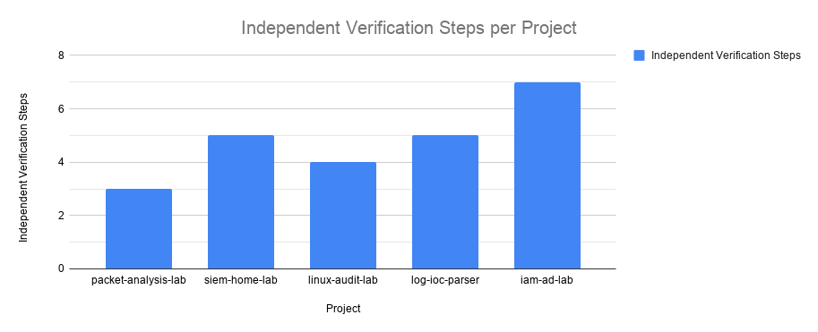
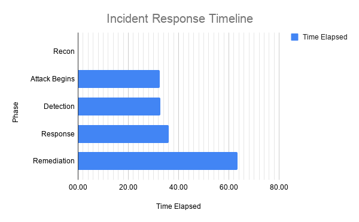
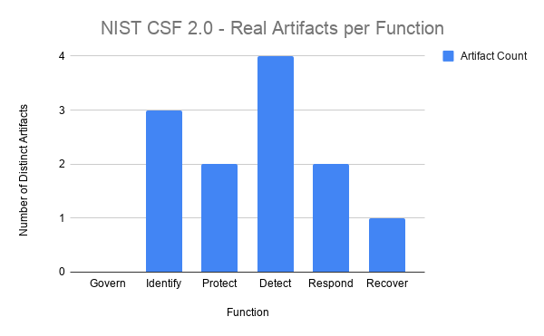

# Cross-Project Security Dashboards

## What this demonstrates

This repo treats reporting and visualization as a skill in its own right. It aggregates evidence from this portfolio's hands-on labs and incident reports into charts, documents one complete security incident from first contact through remediation, and maps the same evidence onto NIST CSF 2.0. None of it is synthetic; every number traces back to a specific, independently verifiable source. The charts and counts are a snapshot as of August 2026; later work is not recounted here. Identifying values are replaced or redacted.

---

## Findings Dashboard — Independent Verification Steps per Project

### What this shows

The number of independent verification steps in each hands-on lab: `packet-analysis-lab`, `siem-home-lab`, `linux-audit-lab`, `log-ioc-parser`, and `iam-ad-lab`.

### Methodology

One test is applied to every project: a step counts when a distinct action confirms a specific claim against a source *independent of the one that made it* — not a single observation, and not routine debugging. The test draws on NIST SP 800-53A Rev 5's Test method (exercising an assessment object under specified conditions to compare actual with expected behavior) and Examine method (checking, inspecting, or reviewing an assessment object to obtain evidence); the independence requirement is this metric's own, not part of 800-53A.

Independence is the part that does the work, and it is easy to get wrong. One candidate step fails on exactly that point: a parser's output compared against a `grep -c` count using the same pattern on the same file. Two counts that share a blind spot are one count run twice.

[`VERIFICATION_STEPS.md`](VERIFICATION_STEPS.md) names all twenty-four counted steps and all six exclusions, and explains why the metric measures independence of evidence source rather than of person.

**Results:**

| Project | Verification steps |
|---|---|
| packet-analysis-lab | 3 |
| siem-home-lab | 5 |
| linux-audit-lab | 4 |
| log-ioc-parser | 5 |
| iam-ad-lab | 7 |

### Key finding

The range from 3 to 7 reflects project scope: `iam-ad-lab` has the most steps because it accumulated the most follow-on work, each addendum adding its own separately confirmed claims. What the count measures is a habit applied consistently: nothing is recorded as verified because a tool said so.

---

## Incident Response Timeline — MTTD from a Single Incident

### What this shows

One complete security incident, run in a single sitting from reconnaissance through remediation. It exercised three parts of this lab together against one attack — [`siem-home-lab`](https://github.com/JSON-MSON/siem-home-lab)'s detection rule, [`iam-ad-lab`](https://github.com/JSON-MSON/iam-ad-lab)'s AD lockout policy, and [`packet-analysis-lab`](https://github.com/JSON-MSON/packet-analysis-lab)'s firewall — for the first time as one incident rather than as separate project demonstrations. The attack was simulated, run deliberately from this lab's own Kali Linux VM against Ubuntu Server (`ubuntu-target`); every timestamp below comes from the resulting logs and alerts.

### The incident

| Phase | Time (UTC) | Elapsed | Evidence |
|---|---|---|---|
| Recon | 14:18:17 | — | Nmap scan against the target, its first probes blocked by the target's firewall ([firewall log](evidence/recon_ufw_block_2026-08-11.txt)) |
| Attack Begins | 14:50:53.06 | +32.60 min | First failed-password log line ([failed-password lines](evidence/auth_failed_password_2026-08-11.txt)) |
| Detection | 14:50:57.46 | +32.67 min | Wazuh rule 100010 fires — **mean time to detect (MTTD) ≈ 4.4 seconds** ([alert record](evidence/mttd_alert_2026-08-11.txt)) |
| Response | 14:54:16 | +35.98 min | AD lockout — the run's own failed logons lock the account ([winbind answers](evidence/winbind_status_2026-08-11.txt)) |
| Remediation | 15:21:47 | +63.50 min | Attacker IP blocked via `ufw` with the corrected rule ([firewall commands](evidence/firewall_fix_2026-08-11.txt)) |

- **Detection.** MTTD runs from the first failed-password line counted by the alert (14:50:53.060) to the alert itself (14:50:57.457); both times come from the same alert record.
- **Response.** When the run began, the account was already locked by a 15-minute lockout set at 14:38:56 during an excluded run. When that lockout expired, the run's next five failed logons locked it again, the fifth at 14:54:16. From then until the run ended, every answer was `NT_STATUS_ACCOUNT_LOCKED_OUT` except five failures at 15:09:18–15:09:28, after that lockout expired, which locked the account again. The run's last failed authentication was at 15:10:18 ([failed-password lines](evidence/auth_failed_password_2026-08-11.txt)).
- **Remediation.** The first deny rule, added at 15:20:10, sat below an existing SSH allow rule (see the second finding below); the corrected rule went in at 15:21:47, and the block was then verified. The account had been unlocked at 15:19:55 ([Samba DC records](evidence/lockout_dc_2026-08-11.txt)).

Three earlier attack attempts that day are deliberately excluded: each was aborted before producing a clean, uninterrupted run. The manager's alert log for the day shows four bursts of rule 100010 activity, beginning at 14:20:54, 14:38:57, 14:45:35, and 14:50:57 ([every alert that day](evidence/rule100010_alerts_2026-08-11.txt)); only the fourth is documented here. OpenSSH enables [`PerSourcePenalties`](https://www.openwall.com/lists/oss-security/2024/07/01/1) by default from version 9.8, penalizing source addresses that repeatedly fail to authenticate, and this target runs OpenSSH 10.2p1. That is the most likely cause of the aborts, though the alert data shows only that they stopped, not why.

### Two findings along the way

**A silently broken response layer, found during preliminary testing.** In the first excluded run (14:20–14:22), the target's winbind answered all 88 failed logons on the targeted account with `NT_STATUS_NO_SUCH_USER` instead of a logon failure ([winbind answers](evidence/winbind_status_2026-08-11.txt)), so none counted toward the domain's lockout threshold and the account was never locked. The SIEM detected the attack correctly throughout, and only a second, independent check surfaced the fault: read on the Samba DC after that run, `badPwdCount` was still 0. Winbind was checked with `wbinfo --online-status` and `wbinfo -t` at 14:30, and `smbcontrol winbindd online` was run at 14:32:41, 18 minutes before the documented attack began. From the next run (14:38:54), failed logons came back as `NT_STATUS_LOGON_FAILURE` and the fifth locked the account, which is why the timeline's Response phase shows a working lockout ([commands and counters](evidence/winbind_fix_2026-08-11.txt)). Why winbind reported the account as nonexistent was not isolated; the target had restarted about three minutes before that run.

**A non-functional firewall rule that reported success.** `sudo ufw deny from 198.51.100.128 to any port 22` was accepted without error while the firewall was active, but a broader, pre-existing `22/tcp ALLOW IN Anywhere` rule sat earlier in the evaluation order. `ufw` stops at the first match, so the deny rule was never reached. It was fixed by deleting the rule and re-inserting it at position 1 ([commands and rule order](evidence/firewall_fix_2026-08-11.txt)), then confirmed two ways, not just by re-reading the rule list: `ufw show added` showing the raw rule order, and a connection attempt from the attacking machine hanging silently — the signature of a working `deny`, where `reject` would refuse at once.

### Key finding

Both findings show the Findings Dashboard's lesson live: a command reporting success and a control functioning are two different claims. Detection caught the attack in under 5 seconds, but both response layers meant to act on it failed silently that day, for unrelated reasons — the AD lockout during preliminary testing, fixed before the incident, and the firewall rule during the incident itself. Neither would have surfaced without a second, separate check.

---

## NIST CSF 2.0 Coverage — Artifacts per Function

### What this shows

A second lens on this portfolio's evidence: artifacts from `packet-analysis-lab`, `siem-home-lab`, `linux-audit-lab`, `iam-ad-lab`, and `incident-reports`, mapped to NIST's CSF 2.0, which organizes security work into six functions: Govern, Identify, Protect, Detect, Respond, and Recover.

### Methodology

Each function is scored by a count of distinct artifacts, not a percentage of the framework's 106 subcategories. Against an enterprise-scale framework, a percentage would either look artificially thin or need stretched evidence to inflate it; a count of citable artifacts stays honest about what a single-operator lab produces. Functions are listed in NIST's published order, not sorted by count, so the chart is not arranged to look better than it is. The table shows representative artifacts for each function and every repo that contributes to its count; [`CSF_ARTIFACTS.md`](CSF_ARTIFACTS.md) names every artifact behind every count, along with the candidates that were excluded and why.

**Results:**

| Function | Artifact Count | Representative Artifacts | Sources |
|---|---|---|---|
| Govern | 0 | — | — |
| Identify | 3 | Full 65,535-port scan of actual attack surface | packet-analysis-lab, iam-ad-lab |
| Protect | 2 | Default-deny host firewall, open ports reduced from five to two | packet-analysis-lab, iam-ad-lab |
| Detect | 4 | Custom Wazuh rules 100010/100011, FIM rule 550, plus scheduled filesystem drift detection | siem-home-lab, incident-reports, linux-audit-lab |
| Respond | 2 | Two full incident reports, each section mapped to CSF 2.0 per SP 800-61 Rev 3 | incident-reports |
| Recover | 1 | Diff-verified backup/restore test, an exercise of RC.RP-05 outside an incident | iam-ad-lab |

### Key finding

The distribution is uneven, and that is the point: Detect carries the operational depth, Recover is light, and Govern is empty. A flat chart across all six functions would read as reverse-engineered to look complete.

Govern holds 31 of CSF 2.0's 106 subcategories, covering organizational risk strategy, policy, and oversight. It is the function furthest from hands-on lab work, and the labs produced no artifact for it. The closest candidate, the decision not to extend monitoring to the domain-joined Windows client, is a risk response for one system, which CSF 2.0 places under Identify (ID.RA-06: "Risk responses are chosen, prioritized, planned, tracked, and communicated"), so it is counted there. The portfolio's formal governance work is a separate deliverable, `governance-risk-lab`: the NIST RMF applied to this environment through a partial assessment of nine controls, with remediation tracked in its plan of action and milestones.

---

## Files in this repo

- `findings_dashboard.xlsx`, `attack_timeline.xlsx`, `nist_csf_coverage.xlsx` — the three charts and their data, built in Google Sheets and exported
- `VERIFICATION_STEPS.md` — the twenty-four counted verification steps and six exclusions, per project
- `CSF_ARTIFACTS.md` — every artifact behind each CSF function count
- `evidence/` — the raw records behind the incident timeline and its two findings
- `screenshots/` — the chart images shown in this README
